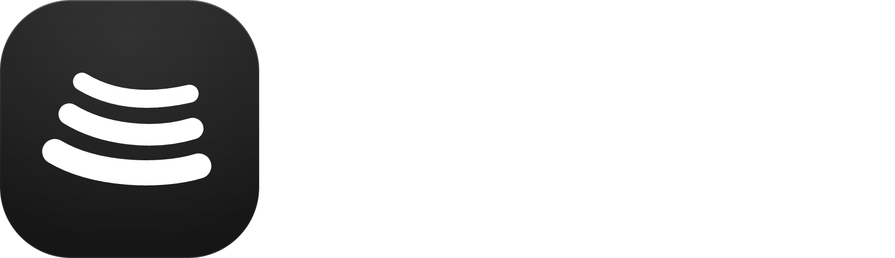

<div align="center">



# BitChord Desktop — Revived

**A desktop music experience, refined.**

**BitChord Desktop - Revived** is an independent, community-maintained continuation of the original BitChord desktop app. It brings together a polished interface, immersive playback, and desktop-first controls for Windows and Linux.


[](LICENSE)

[**Downloads**](#downloads) · [**Features**](#features) · [**Build**](#building-from-source) · [**Roadmap**](#roadmap) · [**Credits**](#credits--upstream)

</div>

> [!IMPORTANT]
> **Independent community project.** This repository continues development of the original PC/desktop app after its discontinuation upstream. It is a fork of [BitChord by @kushagrasinghx](https://github.com/kushagrasinghx/BitChord), but it is **not an official continuation** and is not endorsed, maintained, or supported by the original creator or upstream maintainers. We respect the original work, preserve its attribution and license, and welcome community contributions.


<div align="center">

<h2><a id="download"></a>✨ Highlights</h2>


- **Apple Music Experience** - A refined, modern interface featuring elegant frosted surfaces, adaptive blur, a Mica-inspired sidebar, smooth animations, and seamless light/dark themes.
- **Immersive Music Visuals** - Bring your music to life with Spotify Canvas, Apple Music-inspired animated artist backgrounds, dynamic artwork colors, and beautifully synchronized lyrics.
- **A More Personal Player** - Enjoy a fullscreen listening experience, a resizable floating player, intuitive playback controls, and seamless queue management.
- **All Your Music, One Place** - Explore and stream through YouTube Music, access your Spotify library, discover new releases, and enjoy local music and offline downloads.
- **Powerful Audio Features** - Fine-tune your listening experience with an equalizer, crossfade, experimental Automix, and advanced playback capabilities.
- **Connected Listening** - Stay connected with Discord Rich Presence, Last.fm and ListenBrainz scrobbling, and integrated music services.
- **Made for Desktop** - Designed for Windows and Linux with native media controls, customizable interface options, and keyboard shortcuts like `Ctrl+K` for Quick Search and `Ctrl+/` for the shortcut guide.
</div>

<div align="center">

<h2><a id="download"></a>Download</h2>

<a href="https://github.com/Bntagaaa/BitChord-Desktop-Revived/releases" target="_blank" rel="noopener noreferrer"></a>
<a href="https://github.com/Bntagaaa/BitChord-Desktop-Revived/releases" target="_blank" rel="noopener noreferrer"></a>

**Note:** If you're looking for the Android APK, please download it from the [original BitChord repository](https://github.com/kushagrasinghx/BitChord/releases). This fork is focused on the desktop experience.


</div>

</div>
<div align="center">

<h2><a id="download"></a>⚙️ Build from source</h2>

</div>

**Requirements:** Java 21 and Git.

Windows (PowerShell):

```powershell
.\gradlew.bat :desktopApp:run
```

Linux:

```bash
./gradlew :desktopApp:run
```

</div>
<div align="center">

<h2><a id="download"></a>📜 Credits and license</h2>

</div>

**BitChord Desktop — Revived** is an independent, community-maintained continuation of the original BitChord desktop application, built upon the work of the open-source community.

### Original Project

Special thanks to **[@kushagrasinghx](https://github.com/kushagrasinghx)**, the original creator of [BitChord](https://github.com/kushagrasinghx/BitChord), and all upstream contributors for building the foundation that made this project possible.

BitChord Desktop — Revived preserves the original project's core architecture while introducing desktop-focused improvements, the Visual Astra interface, and additional features for Windows and Linux.

### Acknowledgements

We would also like to recognize the following projects and their contributors:

- **[BitChord](https://github.com/kushagrasinghx/BitChord)** — The original open-source project providing the core playback engine, music integrations, and application architecture.
- **[BitChord-PC-Continued](https://github.com/jackychan4891/BitChord-PC-Continued)** — Maintained by [@jackychan4891](https://github.com/jackychan4891) and its contributors. Portions of its Apple Music artist-motion implementation, including artwork metadata handling, HLS video selection, and playback improvements, have been adapted for Revived. See [PR #71](https://github.com/Bntagaaa/BitChord-Desktop-Revived/pull/71).
- **The open-source community** — Everyone who contributes code, reports issues, tests builds, or helps improve the project.

We sincerely appreciate the work and dedication of all developers whose contributions continue to make BitChord better.

### License

BitChord Desktop — Revived is distributed under the **[GNU General Public License v3.0](https://github.com/Bntagaaa/BitChord-Desktop-Revived/blob/main/LICENSE)**.

This project builds upon GPL-licensed source code from the original BitChord repository and compatible community forks. Original copyright notices and applicable license terms remain in effect.

You are free to use, study, modify, and redistribute the GPL-covered source code under the terms of the license. Distributed modifications must comply with the applicable GPL requirements.

Third-party libraries, fonts, artwork, and other assets may be subject to their own licenses and usage restrictions.

### Disclaimer

BitChord Desktop — Revived is an **unofficial, independent community project**. It is not maintained, sponsored, or endorsed by the original BitChord developers or other referenced community forks.

This project is not affiliated with or endorsed by **YouTube, Google, Spotify, Apple**, or their respective subsidiaries. All trademarks and service names belong to their respective owners.
