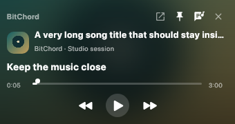
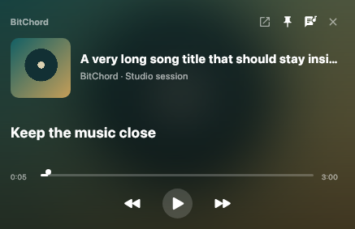
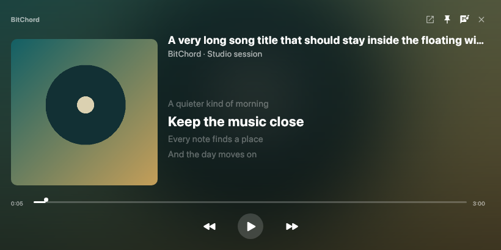
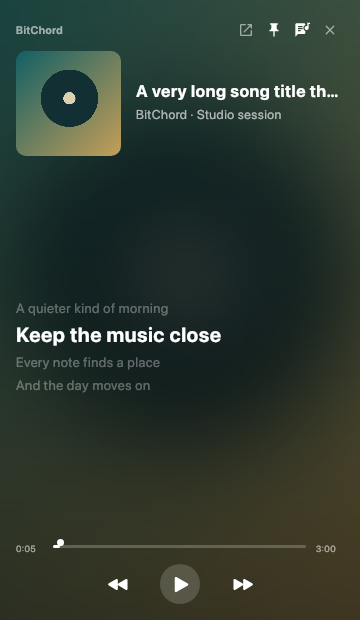
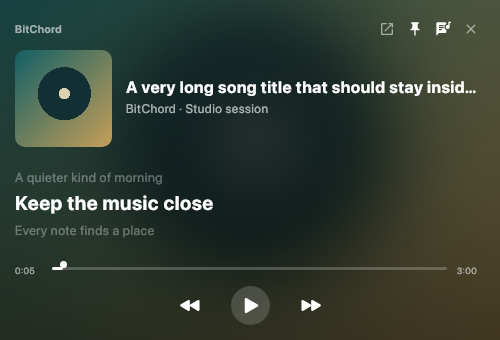
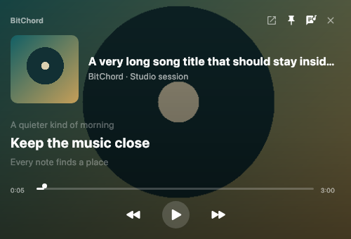
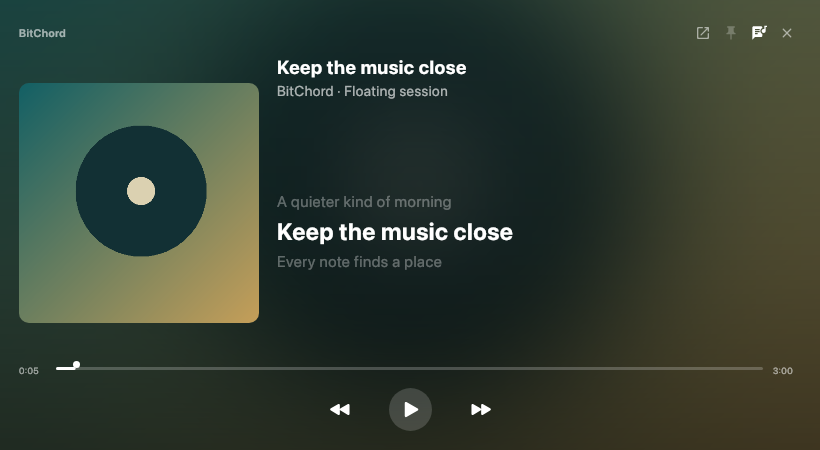

# Desktop PiP rebuild

Base: latest fetched upstream-1109-port. Branch: feature/pip-rebuild-from-scratch.
PR #87 and feature/resizable-pip-player are not implementation inputs.

## Audit and implementation plan

The current base has no standalone PiP window. DesktopApp owns the single audio
engine, queue restrictions, one lyrics lookup/cache, and PlaybackPosition. The
immersive player lives in DesktopPlayerSheet, which owns its desktop fullscreen
control. Main.kt and DesktopWindowVisibility own native close-to-tray behavior.
Shared ArtworkMeshBackdrop prepares and caches the fullscreen player's tiny
pre-blurred cover; global reduceDynamicBlur is authoritative.

A naive second player would duplicate audio/video decoding, lyrics lookups and
artwork decoding; resizing could restart requests, and a stale lyrics result could
appear during a song switch. Window disposal must not release the shared engine.

Implementation responsibilities:
- DesktopPipController: idempotent open/ready/close/restore/dispose state machine.
- DesktopPipSettings: coalesced off-thread persistence of bounds and preferences.
- DesktopPipGeometry: usable monitor bounds, disconnected-monitor recovery.
- DesktopPipWindow: native decorated resizable window, focus/pin/disposal handling.
- DesktopPipHost: application-level sibling of main Window, reading live session state.
- DesktopLyricsSession: one cancellation-safe lookup collector independent of main-window frames.
- DesktopPipState: adapt existing playback/lyrics, responsive sizing and line selection.
- DesktopPipUi: cover-derived background, fluid body, controls and lyrics.
- DesktopApp/PlayerSheet/WindowVisibility: activation buttons, tray setting, existing commands.
- Shared artwork preparation: an optional already-loaded cover input, preserving
  existing fullscreen defaults while avoiding a second PiP fetch.
- Shared PlayerLyrics: a narrow wrapper over the existing lyric clock, allowing a
  visible floating window to keep lyrics moving while another application has focus.

No new playback engine, video renderer, lyric repository or independent blur
preference. Fixed-resolution Coil requests and the existing prepared backdrop
cache are keyed by artwork, never by current window dimensions. Tests cover the
controller, monitor restoration, responsive layout, lyrics, and rendered UI. Native
X11 smoke validation/screenshots will be attempted; Windows and Wayland behavior
will be documented only to the degree actually exercised.

## Implemented behavior

Manual launchers sit beside Lyrics in both desktop player styles and beside
fullscreen in the expanded player. The floating window becomes visible before
the main window is hidden. No load/play/pause/seek is issued on open, close or
restore. Playback commands go through the same app intent functions, including
party restrictions and queue behavior. Artwork is the fallback for music videos;
PiP does not create or attach another video surface.

The Miscellaneous setting **Switch to PiP Mode When Closing App** is shown only
when both Tray icon and Keep playing when closed are enabled. Turning either off
masks automatic PiP without deleting the preference. Failure to open preserves
the normal main/tray recovery path. Returning from PiP or raising the main window
through tray/MPRIS dismisses the floating window.

PiP is an auxiliary window: its Close sends it to the recoverable tray when that
behavior is enabled; otherwise it restores main, keeping music running. Explicit
Quit and ordinary primary-window exit remain separate existing app actions.
Escape restores main; Space toggles playback once per key press. Native caption,
move, resize and system menu are retained. This intentionally favors standard
Windows/Linux behavior over custom frameless resize/drag hacks.

The controller validates request identities so a delayed ready/close/failure from
an old opening cannot affect a newer one. Native close and unexpected peer disposal
are observed; listeners are removed during composition disposal. Window size and
position persist after a quiet resize interval and on normal close. Bounds are
stored in logical AWT coordinates and clamped onto an available monitor on reopen,
including layouts with negative monitor origins and disconnected monitors.
Always-on-top is a persisted native flag, disabled when AWT reports no support.

Lyrics are the existing DesktopApp lookup result, stamped with its owning track.
Canceled lookups cannot overwrite a newer result. The floating lyric uses the same
shared LyricClock and offset/seek rules, with visible-window activity rather than
keyboard focus governing its clock. Timestamped lines, intro, explicit instrumental
gaps and known vocal ends are supported. Unsynced lyrics scroll without pretending
to be timed. Loading, missing and disabled lyrics have explicit states. Show/Hide
Lyrics persists separately from the app's global lyrics enable switch.

## Track-change fix

The original integration called DesktopPipWindow from inside the main Window and
passed a presentation value computed by that window. Compose pauses that parent
composition while main is hidden, leaving the visible floating window with the
previous title/artist/lyrics. The original native lifecycle fixture put the host
at application level, so it did not exercise this production nesting bug.

The regression was reproduced with the production host inside a real main Window:
after selecting the second song while main was hidden, PiP still rendered
`First song`, `First artist`, and `First verse`. Main.kt now hosts PiP as a sibling
of the primary Window. Its session reads the existing snapshot state directly;
the shared PlaybackPosition and playback intent callbacks are retained.

The app's single lyrics lookup now follows snapshotFlow/collectLatest instead of
depending on a track-keyed main-window recomposition. It keeps the duration latch,
provider settings, video/global disable rules, loading/errors and cancellation
fence. Provider overrides are associated with the selected song. Old-track words
are excluded while the new result is loading. Neither engine nor window is
recreated on a track change, and PiP starts no second lyrics lookup.

The new native regression asserts actual rendered semantic text while main stays
hidden, including delayed new lyrics, external track changes, PiP Next/Previous,
one lookup per transition, the same native peer, restore, reopen from a hidden
main window and close. Separate session tests cover late canceled providers,
duration stabilization, disabled video lyrics, provider overrides and errors.

## Rendering and resource bounds

The user-provided small/medium/large SVGs guided composition only. They are neither
fixed-size templates nor production artwork. No red/pink reference colors were
copied. Padding, typography, spacing and transport size vary continuously; a wide
window can use side-by-side composition. Minimum native outer size starts at 340 × 210
logical pixels and includes measured native border/caption insets to retain at
least a 320 × 180 client area; render coverage includes 340 × 180. Title/artist
truncate safely and artwork preserves its ratio with Fit scaling.

The cover uses a fixed 512px Coil request, sharing the app image loader/cache. The
fullscreen player's existing prepared 128px cover blur and eight-entry cache are
reused, deriving the tiny blurred texture from PiP's already-loaded cover instead
of fetching it again, with its neutral fallback and legibility scrim. Neither request depends on
window dimensions. PiP never creates an audio engine, audio decoder, video decoder,
lyrics repository, or polling service.

With Reduce Blur enabled, the prepared-blur composable is not called; a sharp cover
is drawn under the same scrim. The previous blurred image is excluded immediately.
There is no Haze/RenderEffect, text blur, animated video background, or independent
PiP blur setting. Artwork crossfades are short and skip the main transition when
Reduce Animation is enabled. Closing/iconifying disposes image/lyric composition
and stops its frame work. Preferences use one lazy serial daemon, a coalesced
snapshot and a normal-JVM-exit flush. Only the on-close Boolean is observed at app
root, so moving/resizing PiP does not invalidate the whole main application.

These are architectural resource limits, not measured process RSS/CPU savings.
The shared Coil cache may retain bounded reusable images after PiP dismissal.

## Reproduction

Linux native smoke requires a real X11 display or Xvfb:

```sh
BITCHORD_PIP_NATIVE_TEST=1 xvfb-run -a ./gradlew \
  :desktopApp:test :shared:jvmTest :sharedUi:jvmTest :desktopApp:createDistributable
```

The normal test suite runs the rendered UI/model/controller tests. The real AWT
lifecycle test is opt-in; without the variable its method returns without running
that scenario. Local validation explicitly enabled it. Check CI now enables it
under Xvfb on Linux, also runs sharedUi tests on Linux/Windows, and uploads actual
PiP render evidence. Hosted CI results were not observed from this environment.

The UI tests render nine sizes: 340×180, 360×210, 437×283, 500×340, 639×360,
700×350, 820×410, 1000×300 and 360×620. They inspect control/artwork bounds, preserve
cover aspect, delegate a seek once, honor locked controls, change lyrics visibility,
switch blur rendering, and reject old-song lyrics. Paused seeks and positive/negative
offset changes are exercised through the shared clock. The native test checks one
live peer during repeated show requests, resize, pin flags, restore, close-to-tray,
native close, unexpected native disposal and reopening.

## Screenshots and remaining manual QA

The following are actual test renders of production PiP components, using generated
fixture artwork/text, not captures of a live account or an audible music session.
The Xvfb native captures have no full window manager, so they do not certify native
caption styling, drag handles or stacking above another real application.









Before release, check on actual Windows and KDE/GNOME machines:

- Manual activation from both main-player styles and fullscreen, with real audio.
- All tray/keep-playing/automatic-PiP combinations and explicit Quit.
- WASAPI/Linux output, media keys, real queue transitions, seeks and video/audio versions.
- Native resize borders, decorations, focus/Alt-Tab, pin stacking and rapid reopen.
- Multiple monitors, negative origins, disconnect/reconnect and mixed DPI/UI scaling.
- X11 and Wayland sessions through supported AWT/XWayland behavior; no native Wayland
  implementation or compositor-specific global positioning is claimed.
- Bright/dark/missing covers, long/RTL/unsynced lyrics, buffering and global Reduce Blur.

There is no physical audio device or Windows/Wayland runtime here. Listening tests,
Bluetooth, real desktop stacking and app-level end-to-end audio continuity remain
manual QA. Android sources are unchanged. Shared changes are the small clock wrapper/default
visibility override and optional bitmap input to the existing artwork preparation;
existing Android/fullscreen calls retain their defaults. JVM shared tests compile/run it; an Android
SDK/build was unavailable locally. Final numerical/build results are recorded in
[pip-rebuild/validation.json](pip-rebuild/validation.json).

## Recorded validation

- **638 tests passed:** desktop 534, shared 70, sharedUi 34; zero failures/errors/skips.
  The native-window opt-in was explicitly enabled in the full local Linux run.
- The hidden-main regression failed before the fix and passes after it. Rendered
  title/artist/lyrics follow both external changes and PiP Next/Previous without
  recreating the native window. The three new lookup-session tests also passed.
- The local HTTP artwork test returns `Cache-Control: no-store` and observes exactly
  **one request** supplying cover plus prepared background, across subsequent resizes.
- Final Linux `createDistributable` passed. Windows JVM/portable cross-build passed;
  this Linux environment has no `bitchord_analysis.dll`, so the cross-built archive
  is not evidence of a working Automix-enabled Windows release. Actual Windows CI
  compiles its own native helpers and remains unobserved here.
- `actionlint` passed for the changed Check workflow. Existing Android application
  code and unrelated updater/performance branches were not changed or merged.
- Screenshots were inspected after actual rendering. No regressions were observed
  in executed tests; the device/platform checks above remain release QA.

## Pointer controls and lyric transitions

The native regression now clicks the actual window with AWT Robot instead of
invoking semantic actions. It checks Next/Previous title and lyric changes,
Play/Pause icon changes, Return, and Close while main is hidden. These checks use
a fixture playback state, not physical audio output. The expanded pointer test caught a Close failure after reopening. PiP tooltips
now use focusable=false so hover popups cannot take focus from the transport or
window actions. The focused native suite passes after this change. The installed
build and physical audio output still need to be checked on the reporting device.

Lyrics now crossfade over 160 ms and resize over 180 ms, disabled by Reduce
Animation. Vocal breaths shorter than 750 ms retain the preceding line instead of
flashing Instrumental; known vocal ends have a 250 ms grace period. Longer gaps
remain visible and timestamp-based selection still follows seeks.
